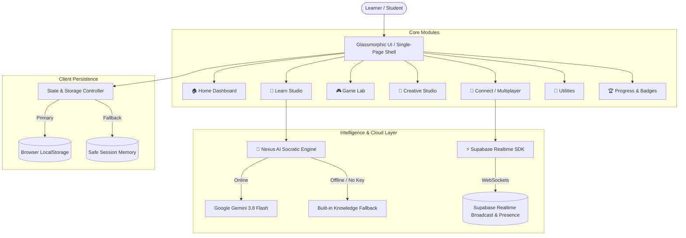

# 🌟 INFERA Learning Hub

<div align="center">


**The AI-Powered Gamified Adaptive Learning Ecosystem**  
*Learn • Play • Create • Connect • Excel*

[Explore Features](#-key-features) • [Quick Start](#-quick-start) • [Architecture](#-architecture) • [Multiplayer Setup](#-multiplayer--social-learning-setup) • [AI Configuration](#-ai-configuration-nexus)

---

</div>

## 📖 Overview

**INFERA Learning Hub** is a next-generation, gamified learning platform engineered to make education engaging, personalized, and interactive. Built as a high-performance, single-file responsive web application, INFERA merges **AI-driven Socratic tutoring**, **gamified cognitive training**, **real-time multiplayer competition**, and **productivity utilities** into an intuitive dark-mode glassmorphic interface.

Whether preparing for high-school exams, training cognitive reflexes, or collaborating in real-time with peers, INFERA adapts to the learner's emotional state, momentum, and pace.

---

## ✨ Key Features

### 1. 🧠 AI Learning Studio (`Learn`)
- **Socratic AI Tutor (Nexus):** Interactively guides students through difficult questions step-by-step using gentle Socratic hints before revealing solutions. Powered by **Google Gemini API** (`gemini-3.8-flash`) with full **offline fallback**.
- **Adaptive Practice Quizzes:** Curated subject tests across Mathematics, Physics, Computer Science, and General Knowledge tailored for Classes 8–12.
- **Concept Explainer:** Break down complex topics into simple intuitive analogies or in-depth technical analysis.
- **Smart Flashcards & Active Recall:** Interactive 3D flip-cards with spaced repetition and confidence tracking.
- **Notes → Quiz Transformer:** Paste lecture notes to automatically generate custom revision quizzes.
- **Timed Exam Simulator:** Practice against countdown timers with performance retrospectives.
- **Targeted Weakness Fixing:** Automatically detects areas where accuracy drops and serves personalized practice.

### 2. 🎮 Cognitive Game Lab (`Play`)
11+ gamified learning experiences designed to reinforce cognitive reflexes, logic, and subject mastery:

| Game | Domain | Cognitive Skill Trained |
| :--- | :--- | :--- |
| 🧠 **Memory Matrix** | Visual Memory | Spatial recall & pattern concentration |
| 🔢 **Math Rush** | Arithmetic | Mental calculation speed under clock pressure |
| 🧩 **Logic Lab** | Deduction | Sequence completion & pattern inference |
| 🔗 **Concept Chain** | Associations | Deep semantic linking over rote memorization |
| 🕵️ **Mystery Case** | Critical Thinking | Deductive investigation and clue analysis |
| 🧪 **Science Lab** | Scientific Reasoning | Hypothesis testing & virtual experiment outcomes |
| 💰 **Smart Budget** | Financial Literacy | Resource management, math & practical budgeting |
| 🧱 **Equation Builder**| Algebra | Structural algebraic formulation |
| ⭕ **Tic-Tac-Toe Quiz** | Strategy | Turn-based grid conquest powered by quiz questions |
| ⚡ **Quick Tap Race** | Motor Reflexes | 15-second reaction speed sprint |
| 👾 **Nexus Boss Battle** | Boss Fights | Multi-phase HP boss battles powered by subject mastery |

### 3. 👥 Real-Time Multiplayer Arena (`Connect`)
- **Live Peer Duels:** 1v1 real-time competitive matches across all game modes (Math Rush Duel, Logic Duel, Memory Matrix Duel, Tic-Tac-Toe, and Boss Battles).
- **Private Room Codes:** Instant room creation with 6-character room codes for quick peer pairing.
- **Lobby Presence:** Live tracking of online peers using **Supabase Realtime WebSockets**.
- **Competitive Scoring:** Live score syncing, speed tiebreakers, and real-time round progression.
- **Leaderboards:** Local and live global ranking boards tracking total XP and match history.

### 4. 🎨 Creative Studio (`Create`)
- **Interactive Doodle Board:** HTML5 canvas with variable brush diameters, full color palette, smooth eraser, and canvas clearing.
- **Creative Quests:** Daily creative challenges encouraging learners to synthesize knowledge by drawing explanatory diagrams.
- **Artwork Persistence:** Save doodles directly with instant XP rewards.

### 5. 🧰 Student Utility Toolkit (`Utilities`)
- 🧮 **Scientific/Standard Calculator:** Fast arithmetic, percentages, and algebraic operations.
- ⏱️ **Focus Timer:** Built-in Pomodoro timer with study intervals and rest cycles.
- 📊 **Grade & Target Calculator:** Weighted percentage calculators and mark estimators.
- 🔄 **Unit Converter:** Real-time unit conversions across Length, Mass, Temperature, Speed, and Data.
- 📐 **Formula Cheat Sheets:** Instant offline lookup for Maths, Physics, and Chemistry formulas.
- 📝 **Quick Notes:** Persistent local markdown/plain-text scratchpad for quick revision notes.

### 6. 🏆 Gamification Engine & Progress (`Progress`)
- **XP & Level Progression:** Six milestone ranks (*Beginner → Curious → Explorer → Scholar → Problem Solver → Master*).
- **Daily Streak Tracker:** Consecutive day check-in tracker with streak rewards.
- **Adaptive Mood Detection:** Dynamic daily mood picker (*Great, Good, Okay, Tired, Low, Stressed, Frustrated, Excited*) that alters recommendations and pacing to prevent burnout.
- **Achievement Badges:** Dynamic unlocks including *7-Day Streak*, *XP Starter*, *XP Hunter*, *Quiz Master*, *Creative Mind*, and *Boss Slayer*.
- **Nexus Insights Engine:** Heuristic analysis identifying whether the student learns best through gaming, creative drawing, or direct question drills.

---

## 🏛️ Architecture



---

## 🚀 Quick Start

### Method 1: Instant Direct Launch (Zero Installation)
Because INFERA is completely self-contained, no `npm install`, dependencies, or build tools are required:
1. Clone this repository:
   ```bash
   git clone https://github.com/Kyzerer/Gamefied_Learning.git
   ```
2. Navigate to the directory:
   ```bash
   cd Gamefied_Learning
   ```
3. Double-click `INFERA_Learning_Hub_Enhanced_Learn.html` (or `index.html`) to launch directly in any modern browser (Chrome, Edge, Firefox, Safari).

### Method 2: Local HTTP Server
To enable optimal clipboard permissions and local network testing:
```bash
# Using Python 3:
python -m http.server 8080

# Or using Node.js:
npx serve .
```
Then navigate to `http://localhost:8080` in your web browser.

### Method 3: GitHub Pages Deployment
1. Go to your GitHub repository: `https://github.com/Kyzerer/Gamefied_Learning`
2. Navigate to **Settings** > **Pages**.
3. Under **Build and deployment** > **Branch**, select `main` and root `/`.
4. Click **Save**. Your site will be live at:
   ```
   https://kyzerer.github.io/Gamefied_Learning/
   ```

---

## 🤖 AI Configuration (Nexus)

INFERA features a dual-mode AI tutoring architecture:

1. **Out-of-the-Box Mode (No Setup Required):**
   - Built-in heuristic Socratic response generator with pre-loaded educational models.
2. **Enhanced Gemini AI Mode:**
   - Click **⚙️ Settings** in the left sidebar.
   - Enter your [Google AI Studio Gemini API Key](https://aistudio.google.com/app/apikey).
   - INFERA leverages `gemini-3.8-flash` to deliver context-aware, step-by-step tutoring.
   - *Security Note:* Your API key is stored strictly inside your browser's local sandbox and is never transmitted to any third-party server.

---

## 🌐 Multiplayer & Social Learning Setup

INFERA uses **Supabase Realtime** for peer-to-peer rooms, presence, and live duels without requiring a custom backend server.

1. Create a free account at [supabase.com](https://supabase.com).
2. Create a new project.
3. In your Supabase Dashboard, go to **Project Settings** > **API**.
4. Copy the:
   - **Project URL** (e.g., `https://your-project.supabase.co`)
   - **Publishable / Anon Key** (`sb_publishable_...` or `anon public`)
5. Open INFERA, navigate to the **👥 Connect** tab, paste the credentials, and click **Connect**.
6. Create a room, share the 6-character room code with a classmate or friend, and start live duels!

> **Security Note:** Only enter public client/anon keys in the browser. Never share your secret or service-role keys.

---

## 🛠️ Technology Stack

- **Core:** Pure Semantic HTML5, Vanilla JavaScript (ES6+), Modern CSS3
- **Design System:** Glassmorphism, CSS Custom Properties (Variables), Responsive CSS Grid & Flexbox, System Typography
- **Graphics & Creativity:** HTML5 `<canvas>` API with stroke smoothing and responsive DPI handling
- **Realtime Networking:** [Supabase JS Client v2](https://github.com/supabase/supabase-js) (`@supabase/supabase-js`)
- **Artificial Intelligence:** Google Generative AI REST API (`gemini-3.8-flash`)
- **Storage:** Fault-tolerant Web Storage API with in-memory fallback for sandbox safety

---

## 📂 Repository Structure

```
Gamefied_Learning/
├── INFERA_Learning_Hub_Enhanced_Learn.html  # Complete single-file learning hub application
├── index.html                               # Seamless launcher & GitHub Pages redirect
├── README.md                                # Comprehensive project documentation
├── LICENSE                                  # MIT Open Source License
└── .gitignore                               # Standard repository ignore configuration
```

---

## 🤝 Contributing

Contributions, feedback, and new game mode ideas are welcome!

1. Fork the Project (`https://github.com/Kyzerer/Gamefied_Learning/fork`)
2. Create your Feature Branch (`git checkout -b feature/AmazingFeature`)
3. Commit your Changes (`git commit -m 'Add some AmazingFeature'`)
4. Push to the Branch (`git push origin feature/AmazingFeature`)
5. Open a Pull Request

---

## 📄 License

Distributed under the **MIT License**. See [`LICENSE`](LICENSE) for more details.

---

<div align="center">

Made with ❤️ for curious minds and self-directed learners everywhere.

**[Back to Top ↑](#-infera-learning-hub)**

</div>
